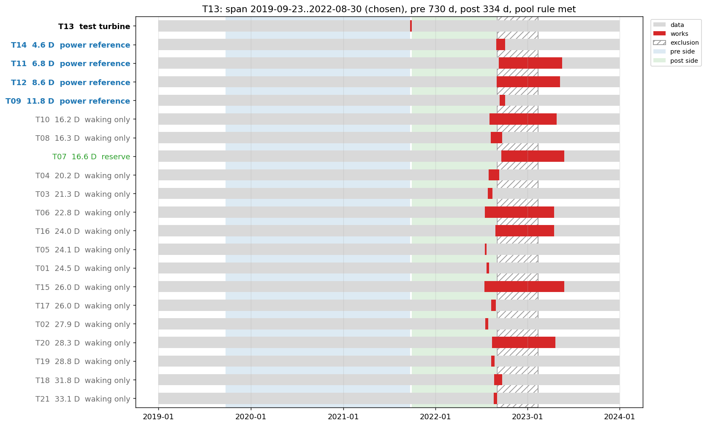
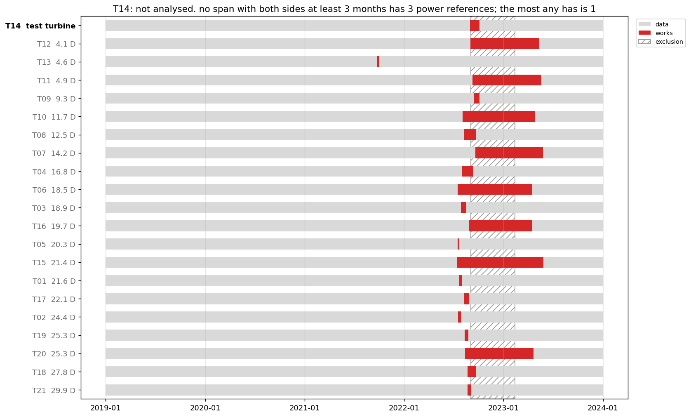

# How wind-up chooses the analysis period and power references

A prepost campaign compares a test turbine's power before its upgrade with its power after, predicted
from reference turbines that were not changed. Which dates count as "before" and "after", and which
turbines count as unchanged, cannot be settled separately: a reference upgraded a month after the
test turbine is unchanged over a short after period and changed over a long one. In a staggered
rollout every test turbine faces this trade-off differently.

`wind_up.analysis_period.plan_analysis` makes the choice for one test turbine, from declared facts
only: every turbine's works windows, every turbine's data extent, the declared exclusions, the layout,
and a few settings. It never reads power. It returns an `AnalysisPlan`: the span, the power
references, the reserves, every other turbine's role with the reason, and whether the pool rule held.
The campaign runner (`benchmarking/campaigns/plans.py`) calls it once per upgraded turbine whenever
the campaign is declared by a works table, and writes each plan beside the report
(`analysis_plans.yaml`, `analysis_plans.csv` and an `analysis_timeline_<turbine>.png`).

The figure shows the plan for T13, the AeroUp trial turbine on Hill of Towie, over the 2019 to 2024
record. Each row is a turbine, the test turbine first and the rest nearest first with their distance
in rotor diameters (D): grey is data, red is works, hatching is an exclusion. The chosen span is
shaded, blue before T13's works and green after.

The pre side runs the full 24 months back from T13's works. The post side stops on 2022-08-30, the
day the nearest turbine T14 started its own AeroUp works, because a span that ran on would lose T14
as a power reference. T10 and T08, 16 D away, started their works earlier in August 2022 and so are
waking only: ending the span before their works would have kept them eligible as reserves, at the
cost of 26 days of post side, and the selector prefers the longer side. T07, 17 D away, is a
reserve: eligible, within reach, but beyond the nearest four. The farm-wide exclusion from September 2022 to February 2023 falls after the span. The
figures on this page are drawn by `benchmarking/baselines/study_analysis_period_doc_plot.py`.

## What makes a turbine eligible as a power reference

Over a candidate span `[start, end)`, another turbine is an eligible power reference when all three
hold:

1. **it has data over the whole span**: its data extent is its first finite active power to its
   last, plus one timebase;
2. **no works window of its own overlaps the span**: a turbine changed entirely before the span
   starts or entirely after it ends is fine; one changed during it is not;
3. **it is within 20 rotor diameters** (`max_reference_distance_d`) of the test turbine.

Distance stands in for how well two turbines' power correlates. Other upgraded turbines are eligible
on the same terms, so a rollout's earlier test turbines can serve as references for its later ones
once their own works are over.

## How a span is chosen

The search is exact over a finite set of candidate edges, so there is no optimiser to get stuck.
The candidate **starts** are:

- the test turbine's own first data;
- the longest pre side sought, `works start − pre_cap` (24 months);
- the edge that yields `pre_cap` of *usable* time once exclusions are subtracted (`reach`, which
  iterates because masked time can push an edge back into more masked time);
- every other candidate's works window **end**, where that ends before the test turbine's works;
- every candidate's own **data start**, so the selector can give up some pre period to reach a
  reference whose data begins late.

The candidate **ends** mirror these, with `side_cap` (12 months) in place of `pre_cap`, works
window **starts**, and candidates' data ends.

Every start × end combination is evaluated. A span is **viable** when both sides are at least
`min_side` (3 months by default) of usable time *after subtracting exclusions*, and it has at least
`min_references` (3) eligible power references.

The viable spans are then ranked, in this order:

| rank by | detail |
|---|---|
| 1. the pool rule | of the test turbine's 4 nearest candidates (`pool_size`), the **nearest must be eligible** and at least 3 of the 4 must be eligible within 20 D |
| 2. the longer short side | `min(pre, post)`, capped at 12 months |
| 3. the longer post | capped at 12 months |
| 4. the longer pre | capped at 24 months |
| 5. more power references | |
| 6. the nearer furthest reference | |
| 7. the later start, then the earlier end | a determinism tiebreak; among otherwise equal spans it prefers the shortest |

The pool rule is a strong **preference**, not a filter: a span that breaks it is still chosen if
nothing else is viable, and the plan records `pool_rule_met: false` with the reason.

The chosen span's power references are the **nearest `k`** (4 by default) of its eligible
candidates. Everything else gets a role and a reason, recorded in `analysis_plans.csv`:

- **reserve**: eligible and within reach, but beyond the nearest `k`. Reserves are what the
  reference screen promotes from when it rules a reference out.
- **waking only**: not eligible, with the reason: `works … overlap the span`, `no data over the
  whole span`, `beyond 20 D`, or `not offered as a reference`.

The plan also records a **reading pool** per reference and reserve: the eligible turbines within
20 D *of that reference*, nearest first, the test turbine left out, which is what each reference is
read against in `reference_stability.csv`. A reference is therefore judged against its own
neighbours rather than against the test turbine's.

## When no span is viable

If no start and end give both sides `min_side` with `min_references` eligible references, the
turbine is **not analysed**. The runner reports it under `unplanned` with the reason, leaves it out
of the estimate and the farm headline, and continues with the other turbines. Only when no turbine
can be planned does the campaign fail.

The second figure shows why. T14 was upgraded in the 2022 rollout, when every other turbine on the
farm was upgraded within a few months of it. Any span with three months on each side of T14's works
overlaps the works of every neighbour, so the only turbine unchanged across it is T13, upgraded the
year before. One reference is not enough.

An analyst has three ways out, in order of preference: wait for more data and a longer after
period, which does not help here because the neighbours were changed too; declare the span and the
references, accepting references whose works overlap it; or lower `min_side`, trading precision for
a reading at all. A rollout designed with wind-up's
[campaign design utility](designing-a-campaign.md) avoids the problem by keeping references
unchanged for each test turbine.

## A declared span

Declaring `analysis_period`, for the campaign or per turbine, skips the search: the span is used as
given. Declared `references` are then **forced in** as power references even when their works
overlap that span, with a warning. A declared span with no power reference at all raises.

## Settings

`PlanSettings` holds the knobs. Every length is usable time: calendar time minus the test turbine's
exclusions.

| setting | default | meaning |
|---|---|---|
| `k` | 4 | power references per test turbine |
| `pre_cap` | 24 months | the longest pre side sought |
| `side_cap` | 12 months | the longest short side, and the longest post side, sought |
| `min_side` | 3 months | the shortest side a chosen span may have |
| `pool_size` | 4 | how many nearest candidates the pool rule looks at |
| `pool_min_eligible` | 3 | how many of those must be eligible and within the distance limit |
| `max_reference_distance_d` | 20 | the furthest a power reference may be, in rotor diameters |
| `min_references` | 3 | the fewest power references a chosen span may have |

The benchmark's prepost campaign matrix lowers `min_side` to 14 days so that synthetic rollouts
with short gaps between works still yield a reading; a real campaign should not.

## What the run writes

For every upgraded turbine, planned or not:

| file | what it says |
|---|---|
| `analysis_plans.yaml` | each plan's span, pre and post lengths, power references and pool rule, and under `unplanned` each turbine no span could be found for, with the reason |
| `analysis_plans.csv` | every other turbine's role for each upgraded turbine, with its distance and the reason it is not a power reference |
| `analysis_timeline_<turbine>.png` | the figures on this page: the span over every turbine's data, works and exclusions, each turbine labelled with its role |

`wind_up.analysis_period_plots.plot_analysis_timeline` draws the figure from the same inputs the
selector used, so what it shows is what the selector saw.
