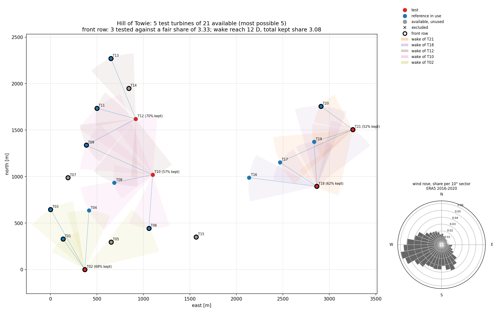
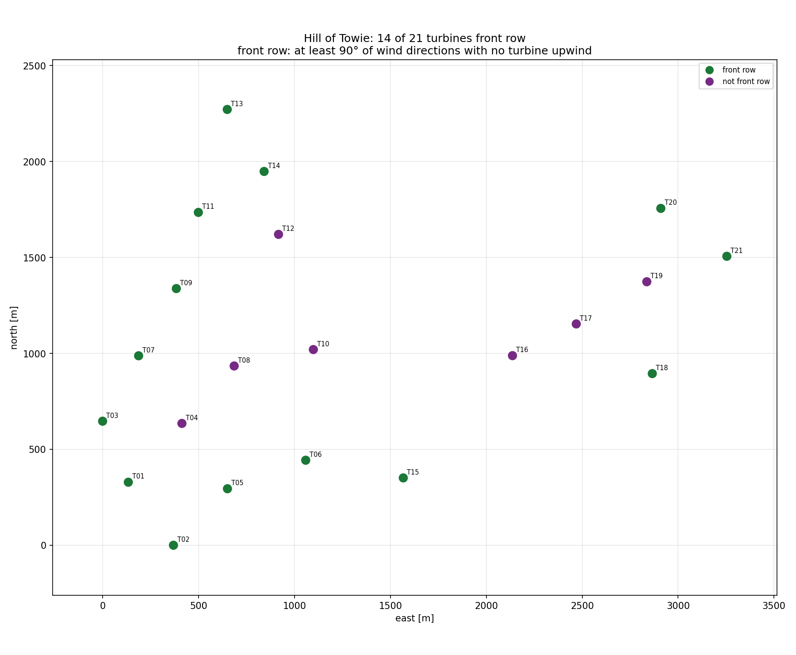
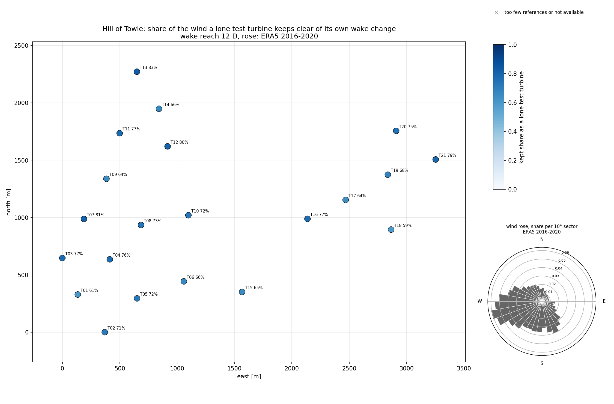

# Designing a campaign with wind-up

Before a campaign runs, someone has to choose which turbines to upgrade. wind-up's campaign
design utility makes that choice for you, or checks one you made by hand, against the reference
rules of the wind-up validation methodology (`docs/wind-up uplift validation methodology v3.pdf`,
step 2): *"A set of reference turbines is chosen for each test turbine. At least three reference
turbines are used where possible."*

It picks **as many test turbines as the site allows** while every one keeps three nearby
references, keeps enough of the wind clear of changed turbines, and the test turbines occupy a fair
share of front-row positions. Among the designs of that size it picks the one that keeps the most
wind usable.

It is not appropriate for upgrades with turbine-turbine interactions, such as wake steering: there
an upgraded turbine changes its neighbours' output, so a nearby reference is not unaffected.

## 1. Describe the site

One row per turbine, as a table (CSV or a pandas DataFrame). Column names are matched
case-insensitively.

| Column | Required | Meaning |
|---|---|---|
| `latitude`, `longitude` | yes | WGS84 degrees |
| `name` | for turbines of the farm under design | Neighbouring turbines you can see in aerial imagery but cannot name may be left blank |
| `rotor_diameter_m` | on at least one turbine | A missing diameter takes the largest one given, which widens that turbine's wake sector (the worst case) |
| `wind_farm` | no | Which farm a turbine belongs to. Neighbouring farms' turbines are drawn in their own colour and only block wakes |

Include neighbouring farms' turbines: they decide which of your turbines are front row.

The same file can serve as the campaign declaration's `turbines.csv` (see
[running a campaign](running-a-campaign.md)); rows without a name are skipped there.

## 2. Say how big the change is, and where the wind comes from

An upgrade can change the wake its turbine casts, and the analysis loses every record in which a
changed turbine is upwind of the test turbine or of one of its references, within the change's
**wake reach** (method step 11 iii). Tell the design how big the change is, and it places the test
turbines so that they lose as little as possible:

| Argument | Meaning |
|---|---|
| `expected_uplift` | The AEP uplift expected of the change, a fraction. It sets the wake reach, as in the campaign declaration: 0 D at 0, 4 D at 1 %, 8 D at 3 %, 12 D at 5 %, 20 D at 10 % or more ([running a campaign](running-a-campaign.md)) |
| `wake_reach_d` | The reach in rotor diameters, overriding `expected_uplift`. `0` for a change that leaves the wakes as they were |
| `offshore` | Doubles the reach taken from `expected_uplift`, up to 20 D |
| `wind_rose` | The site's wind rose: 360 shares, one per degree the wind comes from, summing to 1. Needed for a reach above 0; `wind_up.wake_reach.uniform_rose()` for a site without one, `wind_up.wake_reach.wind_rose(directions)` to build one from a direction series such as ERA5's |
| `rose_label` | What the rose is, for the reports |

With neither `expected_uplift` nor `wake_reach_d` the reach is 0 and the design is as it would be
without this section.

A test turbine's **kept share** is the share of the rose outside every sector in which a changed
turbine is upwind of it or of one of its references within the reach: the test turbine itself upwind
of its references, and any other test turbine upwind of it or of them. The sectors are the IEC
61400-12-1 disturbed sectors that step 5 uses, and overlapping sectors are counted once.

## 3. Say what each turbine may do

Every turbine of the farm under design holds at most one of these roles:

| Argument | The turbine is | Example reasons |
|---|---|---|
| `test_priority` | a test candidate, ranked: first is highest priority | can be used to help ensure representative coverage |
| `reference_only` | never tested, but may be a reference | The upgrade cannot be fitted to it; the owner will not change it |
| `excluded` | neither tested nor a reference | Long-term offline, part of another campaign, a known performance issue |

A turbine you do not list in `test_priority` is a test candidate too. Unlisted candidates follow
the listed ones, chosen to keep the most wind usable, then to keep references as near as possible,
with `seed` settling any remaining choice. If you have no way to rank turbines, pass nothing to
`test_priority`.

## 4. The rules

Each test turbine's candidate references are ranked by distance, except that a candidate the test
turbine is upwind of, within the reach, for more than `demotion_share` (20 %) of the rose ranks
behind every one it is not, as in the analysis (method step 8). "Nearest" below reads "best-ranked"
in this order.

A set of test turbines complies when:

1. **Three references within reach.** Among each test turbine's 4 nearest reference-eligible
   turbines (`reference_pool_size`), at least 3 are not test turbines, and they lie within 20 rotor
   diameters of it (`max_reference_distance_d`). Its references are the 3 nearest of those.
2. **The nearest turbine is always a reference.** A test turbine's nearest neighbour is never
   another test turbine.
3. **A fair share of the front row.** A turbine is front row when at least 90° of wind directions
   (`front_row_min_clear_deg`) reach it with no other turbine upwind, by the IEC 61400-12-1
   disturbed-sector rule. If `F` of the `A` available turbines are front row and `n` are tested,
   the front-row test turbines number `n × F / A` rounded to the nearest whole number (either
   neighbour on an exact half). Too many or too few both fail. Excluded turbines do not count in
   `A` or `F`; reference-only turbines do.
4. **Roles are respected.** Excluded and reference-only turbines are never tested.
5. **Enough wind kept.** Every test turbine's kept share, with its references and the other test
   turbines, is at least `min_kept_share` (0.5).

A turbine may be a reference for any number of test turbines.

## 5. Design

```python
import pandas as pd
from wind_up.campaign_design import design_campaign, write_design

layout = pd.read_csv("turbines.csv")
design = design_campaign(
    layout,
    wind_farm="My Farm",                 # needed only when the layout names several farms
    test_priority=["T07", "T12", "T03"],
    reference_only=["T17"],
    excluded=["T09"],
    expected_uplift=0.05,
    wind_rose=rose,                      # 360 shares, e.g. wind_up.wake_reach.wind_rose(era5_direction)
    seed=0,
)
write_design(design, out_dir="design")
```

wind-up first finds the most test turbines any compliant design allows (`n_test` asks for fewer).
It then walks `test_priority` and keeps each turbine for which a compliant design of that size
still exists, so a higher priority always wins over a lower one, but never at the cost of a test
slot. A turbine that gives way is listed with the reason.

The turbines you did not list then fill the remaining slots. First, wind-up finds the highest
**total kept share** a design of that size can have alongside the turbines already kept. The total
counts the harm each test turbine does to the others, so a front-row turbine that wakes half the
farm in the prevailing wind loses to one that wakes nobody. Among the designs that reach it, wind-up
finds the smallest reference distance that still allows one, and walks the unlisted turbines in the
order drawn from `seed` under that limit. `summary.yaml` reports the total as `total_kept_share` and
the furthest reference any test turbine uses as `reference_limit_d`. A fully listed priority is never
overridden this way; to draw random designs, shuffle the whole priority list rather than rely on
`seed`.

The search for the best total treats the losses as additive, one test turbine and one pair at a
time, so where sectors overlap it slightly undercounts what a design keeps; the reports give the
exact kept shares, and rule 5 is held exactly.

## 6. Check a design you already have

```python
from wind_up.campaign_design import check_design, write_compliance

report = check_design(
    layout, test_turbines=["T02", "T04", "T05"], excluded=["T09"], expected_uplift=0.05, wind_rose=rose
)
print(report.compliant)
for problem in report.problems:
    print(problem)
write_compliance(report, out_dir="check")
```

Non-compliance is reported, never raised, so a failing design can still be inspected.

## 7. Read the outputs

| File | What it holds |
|---|---|
| `compliance.csv` | One row per test turbine: its three references, their distances in metres and rotor diameters, how each one ranks, which are front row, its kept share, and the shares lost to its own wake change (`lost_own_references`) and to the other test turbines (`lost_other_tests`) |
| `wake_losses.csv` | One row per sector a test turbine loses: the waked turbine, the changed turbine upwind of it, their distance, the sector's centre and half width, and its share of the rose |
| `summary.yaml` | Whether the design complies, any problems, the counts, the front-row share against its target, the wake reach, the rose, the minimum and total kept share, the most test turbines possible, the furthest reference used |
| `turbines.csv` | Every farm turbine: its role, the test turbines it serves as a reference, its priority, why it was or was not tested, and its kept share as a lone test turbine |
| `roles.yaml` | A `turbines:` block to paste into the campaign declaration. Every available non-test turbine is offered as a reference, because the analysis uses them all |
| `design_map.png` | A map of the test turbines and their references, each test turbine's kept share, every changed turbine's wake drawn widening from it to each turbine it costs records, and the wind rose |
| `design_map_latlon.png` | The same in latitude and longitude |
| `front_row_map.png` | A map of which turbines are front row |
| `coverage_map.png` | Every turbine coloured by the kept share it would have as a lone test turbine with its own best references: which parts of the farm make good test turbines for this change and this wind |

## A worked example: Hill of Towie

[`examples/v1/design_hill_of_towie.py`](../examples/v1/design_hill_of_towie.py) designs Hill of
Towie's 21 turbines for a 5 % upgrade (a 12 D reach) under the site's ERA5 wind rose, with T17
reference-only and no test priority. Run it from the repository root:

```
uv run python examples/v1/design_hill_of_towie.py
```

It writes the design to `examples/v1/output/design_hill_of_towie/` and refreshes these maps:







At 12 D a test turbine on Hill of Towie keeps 59 % to 83 % of the wind even with its best references,
and the rule of 0.5 caps the design at 5 test turbines; for a 1 % change (4 D) it keeps all of it.

## Limits

- Distance stands in for how well two turbines' power correlates, which is what the methodology
  ranks references by. On complex terrain, check the chosen references against your data.
- Front row is judged from geometry alone, not from the site's wind rose.
- The wake reach is one distance per change, from a wake model's upper bound on the wake change; it
  is not a measured wake, and the sectors are the IEC ones, about twice a modelled wake's width.
- Distances and bearings are computed on the WGS84 ellipsoid.
